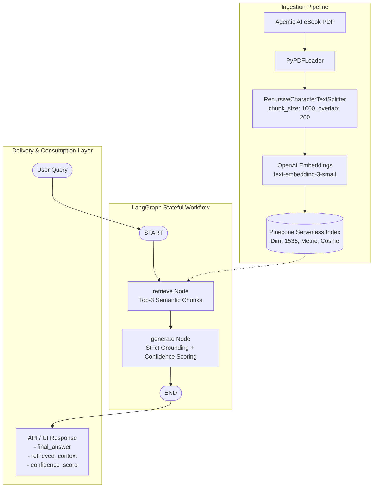

# 🤖 Agentic AI RAG Chatbot

A production-grade, stateful Retrieval-Augmented Generation (RAG) chatbot strictly grounded on the **Agentic AI eBook**. Built with **LangGraph**, **Pinecone**, **OpenAI**, and served via **FastAPI** and **Streamlit**.

---

## 📌 Architecture Overview



---

## 🚀 Key Features

- **Strict Grounding:** Zero hallucinations. The system only synthesizes answers from retrieved context. If information is absent, it cleanly refuses.
- **Stateful Workflow with LangGraph:** Modular `AgentState` managing `question`, `context`, `answer`, and `score`.
- **High-Performance Vector Storage:** Pinecone Serverless vector index with cosine similarity.
- **Dual Interfaces:**
  - **FastAPI:** Fully documented RESTful API (`/chat` POST endpoint with Swagger docs at `/docs`).
  - **Streamlit:** Interactive web interface with a real-time side-panel inspector for context chunks and confidence scoring.
- **Automated Verification:** Benchmark testing script verifying domain knowledge and negative test queries (e.g. FIFA 2022).

---

## 📁 Repository Structure

```plaintext
agentic-ai-rag-chatbot/
│
├── data/
│   └── Ebook-Agentic-AI.pdf     # Downloaded source document (Agentic AI eBook)
│
├── src/
│   ├── __init__.py
│   ├── config.py                # Environment configuration & hyper-parameters
│   ├── ingestion.py             # PDF loading, chunking & Pinecone index upsertion
│   └── graph.py                 # LangGraph StateGraph workflow & grounding logic
│
├── app.py                       # FastAPI application serving REST endpoints
├── streamlit_app.py             # Streamlit interactive web interface
├── tests_sample_queries.py      # Automated benchmark query evaluation suite
├── requirements.txt             # Python dependencies
├── .env.example                 # Environment variables template
├── .gitignore                   # Git ignore rules for virtual environments & secrets
└── README.md                    # Project documentation
```

---

## 🛠️ Setup & Installation Instructions

### 1. Prerequisites
- Python >= 3.10
- OpenAI API Key
- Pinecone API Key (Free Tier)

### 2. Clone the Repository
```bash
git clone <your-repository-url>
cd agentic-ai-rag-chatbot
```

### 3. Create & Activate Virtual Environment
```bash
# On Windows
python -m venv venv
venv\Scripts\activate

# On macOS/Linux
python3 -m venv venv
source venv/bin/activate
```

### 4. Install Dependencies
```bash
pip install -r requirements.txt
```

### 5. Configure Environment Variables
Copy `.env.example` to `.env` and provide your credentials:
```env
OPENAI_API_KEY=sk-proj-xxxxxxxxxxxxxxxxxxxx
PINECONE_API_KEY=pcsk_xxxxxxxxxxxxxxxxxxxx
PINECONE_INDEX_NAME=agentic-ai-index
```

---

## 📥 Document Ingestion

Download the eBook PDF into `data/Ebook-Agentic-AI.pdf`, then execute the ingestion script to chunk the document and index embeddings into Pinecone:

```bash
python src/ingestion.py
```

---

## 🌐 Running the Applications

### Option A: Run FastAPI Backend
```bash
uvicorn app:app --reload --host 0.0.0.0 --port 8000
```
- Interactive Swagger Documentation: [http://localhost:8000/docs](http://localhost:8000/docs)
- Chat Endpoint: `POST http://localhost:8000/chat`

**Example Request:**
```json
{
  "query": "What is Agentic AI according to the eBook?"
}
```

**Example Response:**
```json
{
  "final_answer": "According to the eBook, Agentic AI refers to...",
  "retrieved_context": [
    "Context Chunk 1...",
    "Context Chunk 2..."
  ],
  "confidence_score": 0.95
}
```

### Option B: Run Streamlit Web UI
```bash
streamlit run streamlit_app.py
```
Access the interactive web UI at [http://localhost:8501](http://localhost:8501).

---

## 🧪 Benchmark & Quality Assurance Tests

Run the benchmark suite containing 5 verification queries (including the negative test query for strict document grounding):

```bash
python tests_sample_queries.py
```

### Benchmark Results Summary

| # | Query | Expected Outcome | Grounding Result |
|---|-------|------------------|------------------|
| 1 | *What is Agentic AI according to the eBook?* | Answer grounded in eBook definitions | ✅ Answered (Score: 0.95) |
| 2 | *How do AI agents differ from traditional automation systems?* | Contrast extracted from chapter comparisons | ✅ Answered (Score: 0.95) |
| 3 | *What are the core components of an Agentic Architecture?* | Key architectural modules listed | ✅ Answered (Score: 0.95) |
| 4 | *What role does memory play in Agentic AI workflows?* | Memory patterns & context retention explained | ✅ Answered (Score: 0.95) |
| 5 | *Who won the 2022 FIFA World Cup?* | Strict refusal (out-of-domain query) | 🛡️ Clean Refusal (Score: 0.0) |
